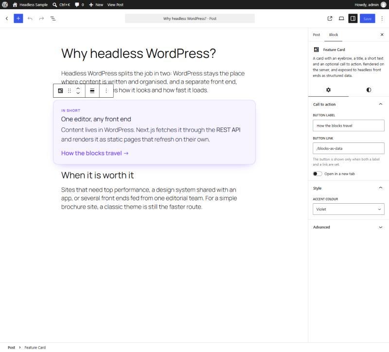
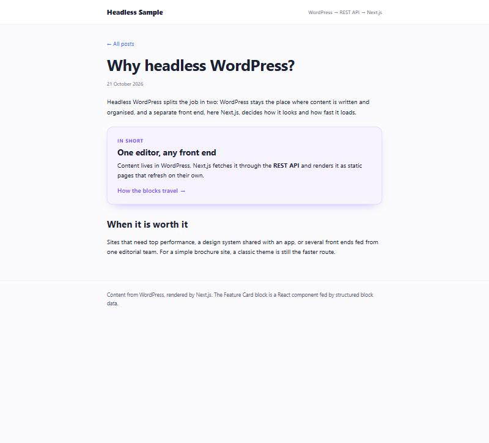

# Gutenberg block + headless Next.js: a code sample

A small, production-style sample of two things working together:

1. **`wp-plugin/feature-card-block`**: a dynamic Gutenberg block (block.json `apiVersion: 3`, React editor, server-side render) that is also exposed to headless front ends as **structured data** through the REST API.
2. **`nextjs-headless`**: a Next.js (App Router, TypeScript) site that reads posts from WordPress and renders that block as a **real React component**, falling back to sanitised HTML for every other block.

**Live demo:** https://gutenberg-headless-sample.vercel.app (try [a post with the block](https://gutenberg-headless-sample.vercel.app/why-headless-wordpress) and [the structured JSON](https://gutenberg-headless-sample.vercel.app/wp-json/wp/v2/posts))

| Block editor | Next.js front end |
| --- | --- |
|  |  |

---

## Why this shape

`content.rendered` gives a headless front end one long HTML string. That's fine for paragraphs and images, but a custom block deserves to be a component with props, not a string to inject. The plugin adds a read-only `structured_blocks` field to posts and pages:

```http
GET /wp-json/wp/v2/posts?_fields=id,slug,title,structured_blocks
```

```json
{
  "name": "headless-sample/feature-card",
  "attrs": {
    "eyebrow": "In short",
    "title": "One editor, any front end",
    "text": "Content lives in WordPress. Next.js fetches it through the <strong>REST API</strong>…",
    "ctaLabel": "How the blocks travel",
    "ctaUrl": "/blocks-as-data",
    "opensInNewTab": false,
    "accent": "violet"
  },
  "html": "<div class=\"feature-card feature-card--violet wp-block-headless-sample-feature-card\">…</div>",
  "innerBlocks": []
}
```

- **Attributes are merged with their block.json defaults** on the server (`WP_Block_Type::prepare_attributes_for_render()`), so the front end never duplicates default values.
- **`html` is the server-rendered output**, so any block without a dedicated component still renders.
- **Why not call the field `blocks`?** The block editor stores the parsed blocks of the post being edited under `blocks` on the same REST record. A REST field with that name collides with it and crashes the editor, so the plugin uses `structured_blocks`.

## The WordPress plugin

```
wp-plugin/feature-card-block/
├── feature-card-block.php     # bootstrap: register_block_type( build/ ), script translations
├── includes/rest-blocks.php   # the structured_blocks REST field
├── src/
│   ├── block.json             # apiVersion 3, attributes, supports, example
│   ├── index.js               # registerBlockType, save: null (dynamic block)
│   ├── edit.js                # RichText + InspectorControls (stable APIs only)
│   ├── render.php             # server-side render, escaped output
│   ├── style.scss             # front end + editor (CSS custom properties)
│   └── editor.scss
└── phpcs.xml.dist             # WordPress Coding Standards ruleset
```

Notes on the choices:

- **Dynamic block (`save: null` + `render.php`)**: markup changes never cause "This block contains unexpected or invalid content" on old posts.
- **Escaping on output**: `get_block_wrapper_attributes()`, `esc_url()`, `esc_html()`, and `wp_kses()` with an explicit inline allowlist for RichText fields.
- **Accessibility**: links that open in a new tab say so to screen readers; an empty card renders nothing instead of an empty box.
- **i18n**: every string goes through `__()` / `esc_html_e()` in PHP and `@wordpress/i18n` in JS, with `wp_set_script_translations()`.
- **Only stable editor APIs**, no `__experimental*` imports.

Quality checks (all clean):

```bash
cd wp-plugin/feature-card-block
npm install && npm run build
npm run lint:js && npm run lint:css     # @wordpress/scripts (ESLint + Stylelint)
vendor/bin/phpcs                        # WordPress Coding Standards, 0 errors / 0 warnings
```

Try it locally with WordPress Playground (no Docker, no database):

```bash
cd wp-plugin
npx @wp-playground/cli server --mount=./feature-card-block:/wordpress/wp-content/plugins/feature-card-block --blueprint=./blueprint.json
```

## The Next.js site

```
nextjs-headless/src/
├── lib/wordpress.ts             # REST client, 'use cache' + cacheLife + cacheTag
├── lib/sanitize.ts              # sanitize-html for every HTML string from WordPress
├── lib/types.ts                 # WPPost, WPBlock, FeatureCardAttributes
├── components/BlockRenderer.tsx # block name → component map, HTML fallback
├── components/FeatureCard.tsx   # React twin of the block (same rules as render.php)
├── app/page.tsx                 # post list
├── app/[slug]/page.tsx          # post page: generateStaticParams + generateMetadata
└── data/snapshot.json           # REST snapshot used when WP_API_URL is not set
```

- **Static and fresh**: pages are prerendered (Next.js 16 Cache Components). Data is cached with `cacheLife('minutes')` and tagged `wp-posts`, so a WordPress "post published" webhook can call `revalidateTag('wp-posts')` for instant updates.
- **SEO**: per-post `<title>`, description and Open Graph tags from the WordPress title and excerpt; unknown slugs return a real `404` with `noindex`.
- **Security**: all HTML from WordPress goes through `sanitize-html`, with a tight inline allowlist for block attributes.
- **Extensible**: adding a component for another block is one line in `BlockRenderer.tsx`.

```bash
cd nextjs-headless
npm install
WP_API_URL=https://your-wordpress-site.com npm run dev   # live WordPress
npm run dev                                              # or the bundled snapshot
npm run lint && npm run typecheck && npm run build
```

Without `WP_API_URL`, the site reads `src/data/snapshot.json`, a snapshot of the same REST responses exported from the WordPress above, so the demo runs anywhere.

## Licence

The WordPress plugin is GPL-2.0-or-later, like WordPress itself. The Next.js app is MIT.
